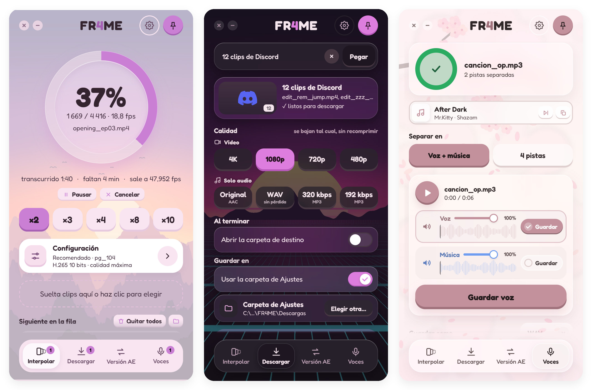
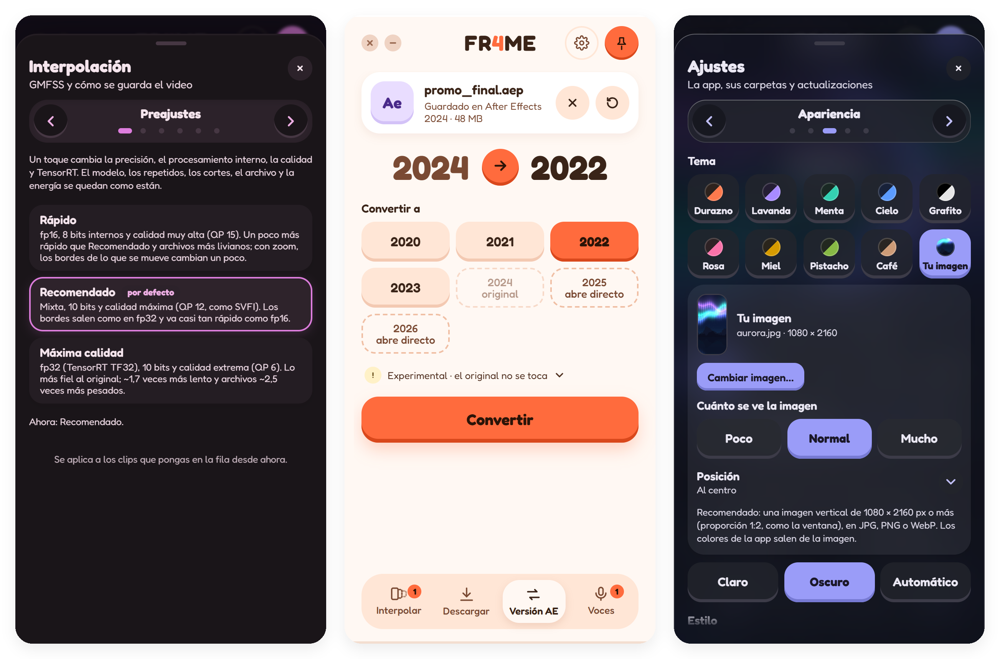
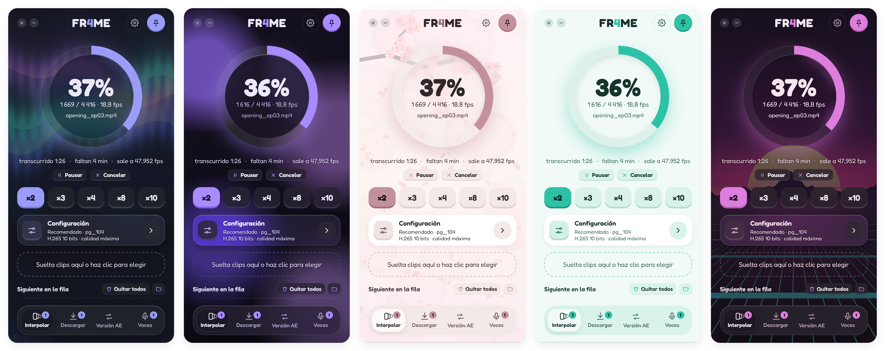

# FR4ME

**Una mini ventana flotante para editores: sube los fps de tus clips con GMFSS, descarga videos, separa voces y abre proyectos de After Effects en versiones viejas.**

---

## ¿Qué hace?

FR4ME es una ventana chiquita que se queda siempre arriba de tus otros programas. Tiene **cuatro funciones** (por eso el 4):

### 🎞️ Interpolar
Pasa tus clips a **×2, ×3, ×4, ×8 o ×10** sus fps con **GMFSS** (Fortuna union), en tu tarjeta NVIDIA. Pensado para clips remapeados de anime y juegos que vas a usar en un edit.

- Quita los **frames repetidos** del anime y suaviza por encima, sin cambiar la duración del clip.
- Detecta los **cortes de escena** para no mezclar dos planos.
- Guarda en **H.265 10 bits** o H.264 con los **colores iguales al original**, listo para After Effects.
- **TensorRT** para ir más rápido (~30 %), precisión Mixta, fp16 o fp32 y 3 preajustes (Rápido, Recomendado, Máxima calidad).
- Pon varios clips en fila: el anillo te dice el %, los fps y cuánto falta. Puedes **pausar** un clip y seguir después, o **detener todo**.

### ⬇️ Descargar
Pega un enlace de **YouTube, TikTok, X, Instagram** y más (con yt-dlp). Te muestra las calidades que tiene el video (con sus fps y tamaño) y el audio solo en **Original, WAV o MP3**. El descargador se actualiza solo.

**Nuevo: clips de Discord de un jalón.** En Discord, selecciona varios mensajes arrastrando el cursor y **suéltalos en FR4ME** (o cópialos con **Ctrl+C** y toca **Pegar**): la app encuentra todos los clips y los baja **en el orden en que se subieron al chat**, cada uno con varias conexiones a la vez. Puedes **pausar, reanudar o detener todo** cuando quieras.

### 🎤 Voces
Separa **voz y música** (o 4 pistas) con **Demucs**. Escucha cada pista, ajusta su volumen y guarda la que quieras. Con **«¿Qué canción es?»** te dice el nombre de la canción (también en Descargar).

### 🎬 Versión AE
Te dice con qué versión de **After Effects** se guardó un `.aep` y lo baja a una versión más vieja (**de 2025 a 2020**) en una copia (tu proyecto original no se toca). *Experimental.*

## Hazla tuya

**9 temas de colores** en modo claro u oscuro, el estilo **Cristal** (en Windows 11 deja ver lo que hay detrás de la ventana) y el tema **«Tu imagen»**: pon la imagen que quieras de fondo y **los colores de la app salen de tu imagen**. Eliges cuánto se ve y qué parte. Está en español e inglés.

### En Discord

FR4ME puede salir en tu perfil de **Discord** como actividad: «Interpolando ×8 · 45 %», «Separando voces», «Descargando un video»…, con el tiempo y el botón para unirse al servidor. Si quieres, también muestra el nombre del clip. Se prende o se apaga en **⚙ Ajustes → Comunidad**, donde ves una vista previa de cómo te ven los demás.

## Descargar e instalar

1. Baja **`FR4ME-<versión>.exe`** de la [última versión](https://github.com/Chinoz17/FR4ME/releases/latest).
2. Ábrelo. Como la app todavía no tiene firma de editor, Windows puede decir *«Windows protegió su PC»*: toca **Más información → Ejecutar de todas formas**.
3. Se instala para tu usuario, sin pedir permisos de administrador.
4. La primera vez que vayas a **Interpolar** o separar **Voces**, toca **Descargar** en el anillo: baja el paquete de GPU (~3,5 GB, una sola vez).

Cuando sale una versión nueva, la app te avisa y se actualiza sola (solo baja lo que cambió).

### Lo que necesitas

| | |
|---|---|
| **Sistema** | Windows 10 u 11 de 64 bits (Cristal transparente solo en Windows 11) |
| **Para Interpolar y Voces** | Tarjeta **NVIDIA RTX** (recomendado 8 GB de memoria de video) |
| **Espacio** | ~0,5 GB la app + ~3,5 GB el paquete de GPU |
| **Descargar y Versión AE** | Funcionan en cualquier PC |

> **Modelos de GMFSS:** la app trae **Fortuna union**. Si tienes **SVFI** (Steam) instalado, también te deja elegir sus modelos **pg_104**, **pg_104 pro** y **pg_117**, que dan menos warping.

## Comunidad

¿Ideas, errores o quieres mostrar tus edits? Únete al servidor **[Kane Sqd en Discord](https://discord.gg/esfyytnsFb)**.

## Créditos

FR4ME usa estos proyectos (gracias a sus autores):

- [GMFSS_Fortuna](https://github.com/98mxr/GMFSS_Fortuna) (MIT): la interpolación.
- [PyTorch](https://pytorch.org/), [TensorRT](https://developer.nvidia.com/tensorrt) y [CuPy](https://cupy.dev/).
- [yt-dlp](https://github.com/yt-dlp/yt-dlp) (Unlicense): las descargas.
- [Demucs](https://github.com/facebookresearch/demucs) (MIT): la separación de voces.
- [FFmpeg](https://ffmpeg.org/) (GPL): leer y guardar video.
- [shazamio](https://github.com/shazamio/ShazamIO) (MIT): «¿Qué canción es?».
- [pywebview](https://pywebview.flowrl.com/) y la letra [Fredoka](https://fonts.google.com/specimen/Fredoka) (OFL).

---

<b>English</b>

**FR4ME** is a small always-on-top window for video editors with four tools:

- **Interpolate:** raise a clip's frame rate ×2–×10 with GMFSS on an NVIDIA GPU (duplicate-frame removal for anime, scene-cut detection, H.265 10-bit output with the original colors, TensorRT).
- **Download:** YouTube, TikTok, X, Instagram and more (yt-dlp), choosing the video quality or audio only. New: drag several Discord messages into FR4ME (or copy them with Ctrl+C and press Paste) to download all their clips in chat order, with pause, resume and stop all.
- **Vocals:** split vocals and music (or 4 stems) with Demucs, plus song recognition.
- **AE Version:** see which After Effects version saved a `.aep` and save a copy for an older version (experimental).

Themes include «Your image»: any picture as the background, with the app colors taken from it. FR4ME can also show what you're doing as your Discord activity (⚙ Settings → Community).

Download `FR4ME-<version>.exe` from the [latest release](https://github.com/Chinoz17/FR4ME/releases/latest). If SmartScreen shows a warning, choose **More info → Run anyway**. Interpolate and Vocals need an NVIDIA RTX card and a one-time ~3.5 GB GPU pack, downloaded from inside the app. The app is available in English (⚙ Settings → General).

